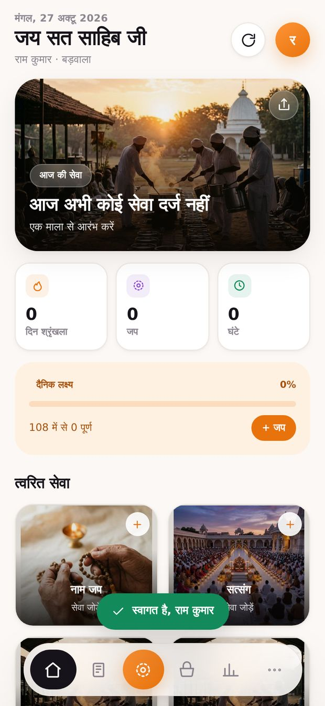
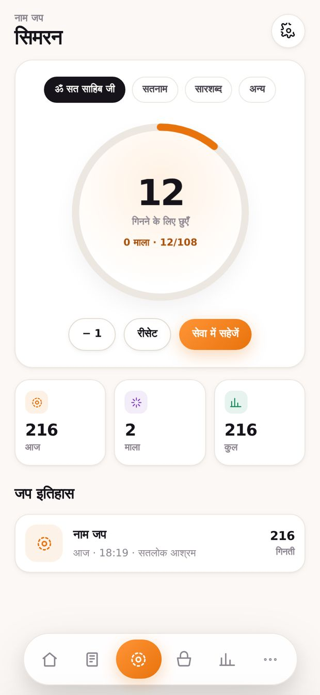
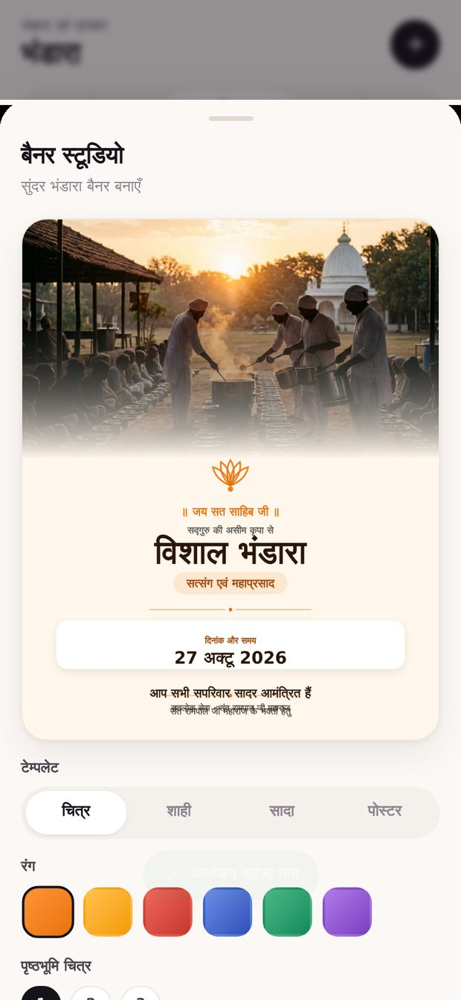
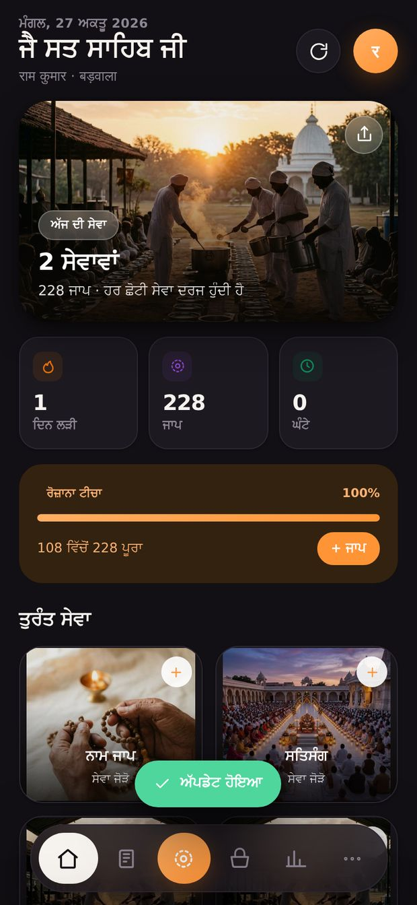

<div align="center">


# सतलोक सेवा · Satlok Seva

**सेवा · सिमरन · संगत**

An offline-first seva diary for the sangat of Sant Rampal Ji Maharaj.

[**Download APK**](https://glitchyapi.github.io/satlok-seva/) · [Release console](https://glitchyapi.github.io/satlok-seva/admin/) · [Version API](https://glitchyapi.github.io/satlok-seva/ota/manifest.json)

</div>

---

## What it is

A native Android app (Java shell + local web bundle) that records daily seva, counts naam jaap,
organises bhandaras, and designs share-ready banners — with **every record sealed on the device**
and **no server that stores anything about a bhagat**.

| | |
|---|---|
| **Package** | `org.satlok.seva` |
| **Min / target SDK** | 23 (Android 6.0) / 34 (Android 14) |
| **APK size** | ~850 KB |
| **Dependencies** | Zero. No AndroidX, no Gradle, no Firebase, no CDN. |
| **Languages** | हिन्दी · English · ਪੰਜਾਬੀ · हरियाणवी |
| **Storage** | DEFLATE-9 → AES-256-GCM, key in Android hardware keystore |
| **Updates** | Signed manifest + per-file SHA-256 delta; APK plane only when native code changes |

<div align="center">




</div>

## Features

- **Seva diary** — 10 seva types, quantity + unit, place, notes, date/time; filter by day/week/month/type; full-text search.
- **Naam jaap counter** — tap counter with mala ring, per-mala vibration, mantra presets, one-tap commit into the diary.
- **Bhandara** — events with venue/organiser/contact, day-before reminders, and a **banner studio**: 4 templates × 6 palettes × 3 aspect ratios, rendered on canvas at 1080 px, saved to the gallery or shared to WhatsApp.
- **Statistics** — 90-day heatmap, current/best streak, weekly bars, seva breakdown donut, lifetime totals.
- **Encrypted vault** — compress-then-encrypt at rest, tamper detection via GCM auth tag, live "space saved" readout.
- **App lock** — optional 4–6 digit PIN (PBKDF2-SHA256, 150 000 iterations) layered over the keystore vault.
- **Portable backup** — one `.ssvb` file, AES-256-GCM with a PIN-derived key (210 000 iterations), deflate-raw compressed; merge or replace on restore.
- **Reminders & notifications** — on-device AlarmManager, exact when permitted, rescheduled after reboot. No push server.
- **Delta OTA** — downloads only changed files, verifies each SHA-256 and the manifest's RSA signature, hot-swaps the bundle, auto-rolls back if the new bundle fails to boot.
- **Broadcasts** — publish an announcement from the console; every device shows it in-app and raises a notification on next launch.

## Repository layout

```
app/
  AndroidManifest.xml
  java/org/satlok/seva/     native shell (8 classes)
    MainActivity.java       WebView + virtual HTTPS origin + overlay resolution
    Bridge.java             the whole JS ⇄ Java surface
    SecureStore.java        DEFLATE + AES-256-GCM vault
    OtaEngine.java          manifest verify, delta plan, apply, rollback, APK plane
    Notify.java             channels, reminders, exact-alarm handling
    ReminderReceiver.java   fires + re-arms
    BootReceiver.java       reschedules after reboot / package replace
    ShareProvider.java      minimal ContentProvider (no AndroidX)
  assets/www/               the product — this is what OTA patches
  res/                      adaptive icons, splash, themes
admin/index.html            release console (static, GitHub Pages)
index.html                  public download page
scripts/
  build_apk.sh              aapt2 → javac → d8 → zipalign → apksigner
  publish.py                hash, diff, sign, atomic commit
  make_icons.py             derive every icon from one emblem
ota/                        generated: manifest.json + bundle files + apk/
release/                    generated: latest.json + APK
build.json                  single source of version truth
```

## Build

The toolchain lives in `../tools` (JDK 17, Android build-tools 34, platform 34). No Gradle.

```bash
bash scripts/build_apk.sh          # → dist/SatlokSeva-<ver>-<code>.apk
```

Bump `build.json` first. `versionCode`/`versionName` gate APK installs; `webBuild`/`webVersion`
gate content patches. The build writes `app/assets/www/_lock.json` (SHA-256 of every bundle file),
which is what makes delta updates possible.

## Publish

```bash
export GH_TOKEN=ghp_…
python3 scripts/publish.py --notes "नए बैनर टेम्पलेट" --notes "तेज़ खोज"
python3 scripts/publish.py --apk --notes "Android 15 support"   # only when native code changed
```

Or use the [release console](https://glitchyapi.github.io/satlok-seva/admin/) — drag the `www`
folder in, and it uploads only what changed, signs the manifest in your browser, and commits
everything atomically.

## How the update system works

Two independent planes, one universal URL.

```
                    ┌──────────────────────────────────────┐
   admin console ──▶ │ ota/manifest.json  (RSA-2048 signed) │ ◀── any static host
                    └──────────────────────────────────────┘
                                     │  app reads on launch
                     ┌───────────────┴────────────────┐
                     ▼                                ▼
            web.build > local?                shell.versionCode > local?
                     │                                │
        hash every local file              download APK, verify SHA-256
        download ONLY mismatches           hand to Android installer
        verify each SHA-256
        swap into overlay/
        reload WebView
        boot watchdog → auto-rollback on failure
```

- **Content plane** handles ~99 % of releases: UI, logic, translations, images. A typical patch is a few KB and needs no reinstall.
- **Shell plane** is only for native changes (new permission, new bridge method). The app downloads the APK, verifies its hash, and opens the system installer.
- **Signature pinning**: `app/assets/www/ota-pubkey.txt` holds the SPKI public key. A manifest whose signature does not verify is refused, so owning the file host is not enough to push code.
- **Mirrors**: `web.mirrors[]` is tried in order when the primary host fails — this is where a OnlyFiles-style direct-link host, jsDelivr, or any CDN plugs in without an app change.

See [`docs/ARCHITECTURE.md`](docs/ARCHITECTURE.md) for the full design and [`docs/OPERATIONS.md`](docs/OPERATIONS.md) for the release runbook.

## Permissions and why

| Permission | Why | Requested |
|---|---|---|
| `INTERNET`, `ACCESS_NETWORK_STATE` | read the update manifest | install |
| `POST_NOTIFICATIONS` | reminders + update alerts | runtime, on first reminder |
| `SCHEDULE_EXACT_ALARM` / `USE_EXACT_ALARM` | fire the daily reminder on time | settings, if needed |
| `RECEIVE_BOOT_COMPLETED` | reschedule reminders after reboot | install |
| `VIBRATE` | mala feedback | install |
| `REQUEST_INSTALL_PACKAGES` | install its own APK updates | runtime, first shell update |
| `READ_MEDIA_IMAGES` (33+) | save banners to the gallery | runtime, first save |
| `READ/WRITE_EXTERNAL_STORAGE` (`maxSdkVersion=28`) | same, on Android 9 and older | runtime |

Backups use the Storage Access Framework, so **no broad storage permission is needed on Android 10+**.
Cloud backup and device transfer are explicitly disabled so the encrypted vault never leaves the phone by accident.

## Keys — keep these safe

`keys/` is git-ignored and must stay that way.

| File | Purpose | If lost |
|---|---|---|
| `release.keystore` | signs the APK | you can never ship an update to existing installs |
| `manifest-private.pem` / `.jwk.json` | signs update manifests | you must ship a new APK with a new pinned public key |

The release console can import `manifest-private.jwk.json` and sign entirely in the browser.

## License

Source available for the sangat. Not affiliated with or endorsed by any ashram; built as a service.

<div align="center"><sub>जय सत साहिब जी 🙏</sub></div>
